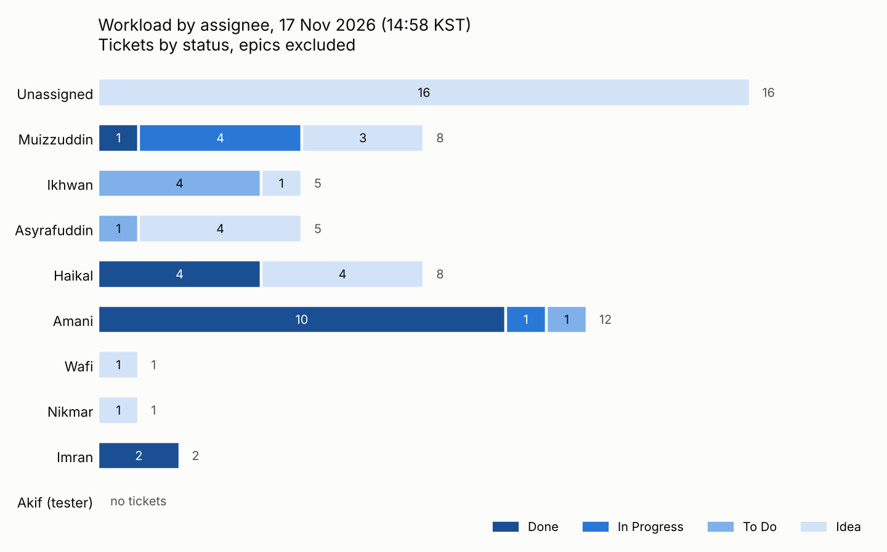

# Workload analysis, 17 Nov 2026

Part of the workflow review in [`../PROCESS.md`](../PROCESS.md). Based on Jira project GOG at about 14:58 KST, before any reassignment. Epics are not counted.

## Tickets per person

| Person | Done | In Progress | To Do | Idea | Total |
|---|---|---|---|---|---|
| Unassigned | 0 | 0 | 0 | 16 | 16 |
| Muizzuddin | 1 | 4 | 0 | 3 | 8 |
| Ikhwan | 0 | 0 | 4 | 1 | 5 |
| Asyrafuddin | 0 | 0 | 1 | 4 | 5 |
| Haikal | 4 | 0 | 0 | 4 | 8 |
| Amani | 10 | 1 | 1 | 0 | 12 |
| Wafi | 0 | 0 | 0 | 1 | 1 |
| Nikmar | 0 | 0 | 0 | 1 | 1 |
| Imran | 2 | 0 | 0 | 0 | 2 |
| Akif (tester) | 0 | 0 | 0 | 0 | 0 |

Haikal's 4 "Idea" tickets are the documentation tickets GOG-64 to 67. The unassigned 16 are GOG-16, GOG-39 to 52 and the new GOG-68.

## What the numbers show

1. **16 tickets have no owner.** That is the largest block of work, and under the evaluation rules it would count for nobody.
2. **Muizzuddin has 4 tickets In Progress at once** (GOG-6, 23, 35, 37) and 7 open in total. That is the highest load among the people with open work, and it breaks the WIP limit of 2 we plan to adopt.
3. **Three people have almost no visible work:** Wafi and Nikmar have 1 ticket each (both still Idea), and Imran has 2, both Done. Akif has none.
4. **Amani's board looks large but is mostly finished.** Of his 12 tickets, 10 (GOG-53 to 62) were marked Done within about a minute of each other at 14:40-14:41, so only GOG-9 (To Do) and GOG-11 (In Progress) remain open.
5. **Overall progress is low:** 17 of 58 non-epic tickets (29%) are Done, 5 are In Progress, and the other 36 have not started (To Do or Idea). That is risky with 21 days left.
6. **Ikhwan and Asyrafuddin hold 5 tickets each, and almost none have started** (only 1 of Asyrafuddin's is To Do, 4 of Ikhwan's are To Do).

## A note on how tickets were closed

Amani's 10 subtasks were created between 14:19 and 14:21 and closed in bulk at 14:40-14:41. The repo already contains the stamina code, so the work was probably done before the tickets existed. This is fine for our records, but the professor reads Jira as a log of how the work happened. For the remaining three weeks the team agrees to **create the ticket before or when starting the work, and move it as it progresses**, so the dates reflect reality.

## What this means for the plan

- Amani now has capacity, so the skill-tree tickets (GOG-50 to 52) can go back to him, as first proposed.
- Muizzuddin's load should be reduced by moving GOG-30, GOG-31 and GOG-35 to others (see section 9 of PROCESS.md). GOG-35 is already In Progress, so check with him before moving it.
- Wafi, Nikmar and Imran should take most of the unassigned work.
- Akif needs a visible set of tickets (on hold until we ask him).
